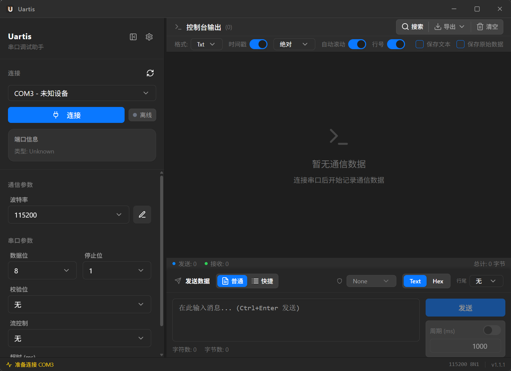

# T1 自绘标题栏 Spike 记录（Windows）

> 日期：2026-11-06
> 分支：`feature/titlebar-spike`（从 `develop` 拉，仅原型，不合并 main）
> 环境：Windows 11 x64，150% 缩放，WebView2，Tauri 2.12.5
> 关联：[`TITLEBAR-PLAN.zh-CN.md`](TITLEBAR-PLAN.zh-CN.md) §5.1

## 1. 本次实现

- `src-tauri/tauri.conf.json`
  - macOS：`decorations: true` + `titleBarStyle: "Overlay"` + `hiddenTitle: true` + `trafficLightPosition`（保留原生红绿灯）。
- `src-tauri/src/main.rs`
  - Windows/Linux 在 `setup` 中调用 `window.set_decorations(false)`，移除系统标题栏。
- `frontend/src/components/TitleBar.tsx`（新增）
  - 36px 自绘栏：应用图标 + `Uartis` 标题 + Win/Linux 三个窗口按钮。
  - 空白区使用 `data-tauri-drag-region`；按钮不参与拖动。
  - 依赖 Tauri 内置 drag-region 脚本处理拖动与双击最大化。
- `frontend/src/App.tsx`
  - 在根布局顶部挂载 `<TitleBar />`，主内容区改为 `flex-1`。
- `frontend/src/utils/platform.ts`
  - 修复 `isMacPlatform()`：Windows WebView2 在本机环境下返回了偏 macOS 的 platform 字符串；现在显式 Windows UA 优先。
- `src-tauri/capabilities/default.json`
  - 增加 `core:window:allow-start-dragging` / `allow-minimize` / `allow-toggle-maximize` / `allow-close` / `allow-is-maximized`。

## 2. 验证结果（Windows）

| 项 | 结果 | 说明 |
|---|---|---|
| 系统标题栏移除 | ✅ | 客户端区域顶到窗口顶部；截图无原生 caption |
| 自绘栏渲染 | ✅ | 36px，图标/标题/右侧三按钮 |
| 最大化按钮 | ✅ | 点击后 `IsZoomed(hwnd) === true` |
| 双击标题栏最大化 | ✅ | 依赖 Tauri 内置 `internal_toggle_maximize`；**不要自己再加 `onDoubleClick`/`onMouseDown`，否则会二次切换** |
| 拖动窗口 | ✅ | 空白区按住拖动，窗口位置从 20,20 移到 145,80 |
| 最小化按钮 | ✅ | 点击后 `IsIconic(hwnd) === true`，可恢复 |
| 关闭按钮 | ⏳ 人工 | 按钮已渲染；点击会退出应用 |
| 平台检测 | ✅（已修） | 修复前误判为 macOS，自绘栏 padding/按钮错误 |
| Snap Layouts | ⏳ 待测 | 自绘最大化按钮预计丢失 Win11 悬停布局 |
| DPI/多屏 | ⏳ 待测 | 150% 下渲染正常；100/125/200% 与跨屏待测 |
| macOS / Linux | ⏳ 待测 | 当前无实机；配置已按计划写入 |

## 3. 关键发现

1. **Tauri 已内置拖拽区双击最大化**（`tauri/src/window/scripts/drag.js`）：`data-tauri-drag-region` 在 `mousedown detail===2` 时调用 `internal_toggle_maximize`。自己再监听 `onDoubleClick` 会触发两次，导致最大化后立即还原。
2. **必须显式 `preventDefault`/`stopImmediatePropagation` 的交互元素**：按钮是 clickable tag，Tauri 会自动阻止拖动；不要给按钮加 `data-tauri-drag-region`。
3. **Windows WebView2 平台识别不可靠**：原 `isMacPlatform()` 只看 `navigator.platform`/`Mac OS`，本机被误判。已改为 Windows UA 优先。
4. **运行时 `set_decorations(false)` 可行，但会有一帧原生标题栏**；正式实现建议用平台配置文件（`tauri.windows.conf.json` / `tauri.linux.conf.json`）在创建窗口时就去掉装饰，避免闪烁。
5. 截图脚本本身有 DPI 虚拟化问题，必须 `SetProcessDPIAware()` 后按客户区坐标截图；这不是应用 bug。

## 4. 结论

- **Windows：条件 Go（核心交互已通过）**：渲染/拖动/双击最大化/最大化按钮/最小化通过；Snap Layouts、DPI/多屏、关闭按钮需补测。
- **macOS/Linux：待测**；T1 整体 Go/No-Go 需在实机完成后再定。
- 不合并 `feature/titlebar-spike`；T2 按本笔记实现正式组件。

## 5. T2 待办

- [x] 用平台配置文件替代运行时 `set_decorations`：`tauri.windows.conf.json` / `tauri.linux.conf.json` 创建时即 `decorations:false`；macOS 在 `tauri.macos.conf.json` 保留 `decorations:true` + `Overlay`/`hiddenTitle`。
- [ ] 手动验证拖动、最小化/关闭、Snap Layouts、100/125/150/200% DPI、多显示器。
- [ ] macOS：原生红绿灯安全区、全屏、⌘W/⌘M/⌘Q。
- [ ] Linux：GNOME/KDE X11/Wayland 拖动/resize、平铺 WM。
- [ ] 把 `TitleBar` 接入正式设计 token/主题，补 `aria-label`/键盘/高对比。
- [ ] 兼容模式设置与窗口状态记忆。

## 6. T2 平台配置进度（2026-11-06）

- 基础 `tauri.conf.json` 只保留跨平台公共窗口字段；不再写 macOS 专属 `titleBarStyle`/`trafficLightPosition`。
- 新增 `tauri.windows.conf.json`、`tauri.linux.conf.json`、`tauri.macos.conf.json`，每个平台提供完整窗口对象，避免数组合并歧义。
- 删除 Rust `setup` 中的 `set_decorations(false)`，窗口创建时即为无边框，消除首帧原生标题栏闪烁。
- Windows 150% DPI 构建 + 启动截图确认：自绘标题栏、按钮、玻璃与控制区正常，无原生 caption。
- T2 组件拆分：新增 `hooks/useWindowControls.ts` 与 `components/WindowControls.tsx`；`TitleBar` 只负责布局/安全区，按钮标签走 i18n（`titleBar.*`）。
- Windows 再次截图确认拆分后按钮/玻璃/布局无回归；`tsc`/lint/format/Vitest（12）/Vite+NSIS build 通过。
- macOS/Linux 仍需实机验证；若平台配置未按预期合并，回退方案是恢复 Rust `set_decorations` 并记录。

