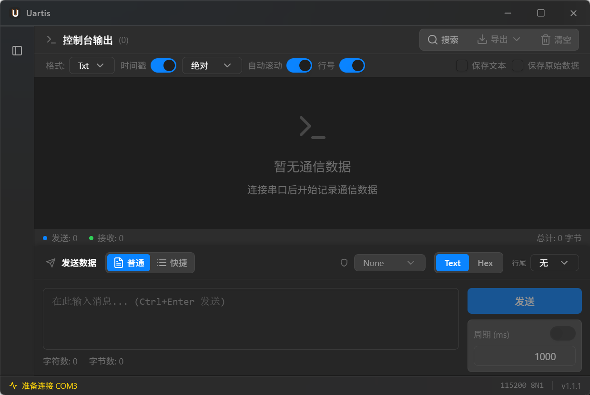

# UI V6 验收记录（Windows，初验）

> 日期：2026-11-06
> 环境：Windows 11 x64，150% 缩放，WebView2，Tauri 2.12.5，release 构建
> 关联：[`UI-VISUAL-PLAN.zh-CN.md`](UI-VISUAL-PLAN.zh-CN.md) V6

## 1. 最小尺寸 840×560

初测发现两个问题，已修复并复验：

1. 840 宽时侧栏仍展开，日志工具条被压成竖排、右侧控件被裁切。
   - 修复：`AUTO_COLLAPSE_THRESHOLD` 640 → **900**，840 宽自动折叠侧栏。
2. 窗口变矮后，持久化的日志区高度没有重新 clamp，发送区被挤出屏幕。
   - 修复：窗口 `resize` 时重新按 `mainContentHeight - sendPanelMinHeight` clamp 日志区高度；日志工具条支持 `flex-wrap`。

复验截图（1238×827 物理像素，约 840×560 逻辑像素）：

结果：侧栏折叠、日志工具条两行内可读、发送区完整可见（输入框/发送按钮/周期控件），底部状态栏正常。

## 2. 已完成的检查

- [x] 自绘标题栏 + 玻璃壳层 + 控件在最小尺寸下可用
- [x] 暗色主题冒烟（Windows 150%）
- [x] 日志工具条折行（`flex-wrap`）
- [x] 窗口 resize 后日志/发送区不溢出
- [x] `tsc` / ESLint / Prettier / Vitest（12）/ Vite build / Tauri NSIS 构建
- [x] 构建产物：CSS gzip 8.21 kB，JS gzip 145.87 kB（V6 构建）
- [x] 外观设置扩展：跟随系统、强调色 4 套、毛玻璃强度 3 档、减少动效
- [ ] 外观设置截图/交互手测（系统主题切换、强调色、强度、减少动效）

## 3. 尚未完成

- [x] 高对比模式可在 设置 → 外观 手动开启（`data-contrast="more"`：实底、强边框、更高文字对比）；截图待补
- [ ] 亮色主题截图；高对比模式截图（开关已实现，未做视觉基线）
- [ ] 完整键盘 Tab 顺序 / 屏幕阅读器抽查
- [ ] 1000 行日志滚动 FPS、窗口拖动/缩放 FPS 量化
- [ ] macOS WKWebView、Linux WebKitGTK 验收
- [ ] 版本号提升到 v1.2.0、发布说明与 rc/正式 Tag

## 4. 结论

Windows 上的 **最小尺寸可用性已闭环**；V6 仍不能算全部完成，剩余主要是主题/高对比截图、FPS、macOS/Linux 实机与发布准备。
